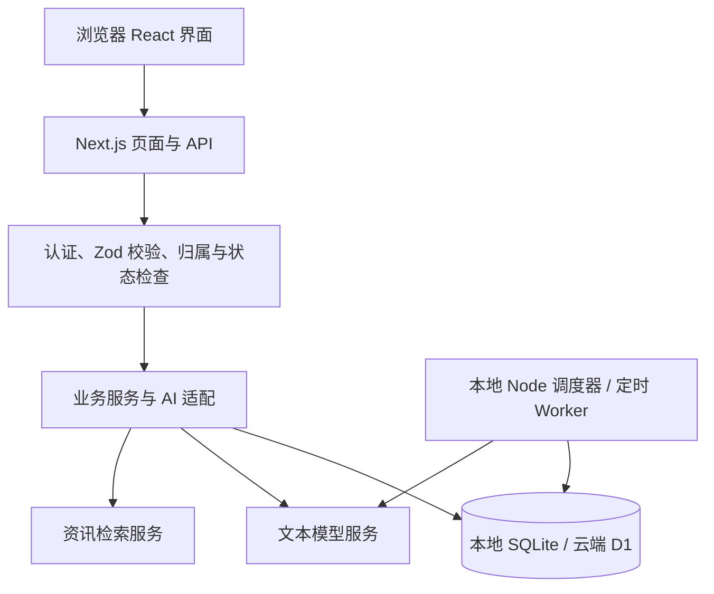

# AI 工作台技术文档

文档日期：2026-10-15。产品版本：`0.1.0`。代码基线：`72bb9e5`。

相关文档：[产品需求](产品需求文档.md) · [使用说明](使用说明文档.md) · [发布记录](deployment-2026-10-15.md)。本文不包含环境变量值、账号凭据和个人业务数据。

## 1. 架构



前后端属于同一个 Next.js 应用，API 在同域 `/api/*`。云端另有后台调度 Worker，共享 D1，但不提供独立用户页面。本地网页进程与调度器是两个进程。

| 技术 | 当前用途 |
| --- | --- |
| Next.js 15.5、React 19 | 页面、路由及服务端 API |
| TypeScript 5.7、Zod 3 | 类型约束和输入/AI 输出结构校验 |
| Tailwind CSS 3、lucide-react | 样式和图标 |
| Prisma 6、SQLite/D1 | 数据模型和持久化 |
| OpenNext、Cloudflare Workers | Next.js 云端适配和定时执行 |
| JSZip | 档案及代码快照打包 |
| Vitest、Playwright | 逻辑测试与浏览器验证 |

本地要求 Node.js 24+、npm 11+；初始化和备份脚本使用 `node:sqlite`。

## 2. 目录与入口

| 路径 | 职责 |
| --- | --- |
| [src/app](../src/app) | 页面、登录和 API route handlers |
| [src/components/Workbench.tsx](../src/components/Workbench.tsx) | 主导航、页面组合与计划复盘 |
| [src/components/MyWorkbench.tsx](../src/components/MyWorkbench.tsx) | 统一任务工作台 |
| [src/components/strategy](../src/components/strategy) | 自我认知、战略规划和研判界面 |
| [src/lib](../src/lib) | 数据访问、业务规则、AI 和备份逻辑 |
| [prisma/schema.prisma](../prisma/schema.prisma) | 主数据模型 |
| [scripts](../scripts) | 本地迁移、后台、备份和发布核验 |
| [cloudflare/migrations](../cloudflare/migrations) | D1 增量 SQL |
| [cloudflare/daily-worker.ts](../cloudflare/daily-worker.ts) | 定时 Worker 入口 |
| [wrangler.jsonc](../wrangler.jsonc) | 网站 Worker 与 D1 配置 |
| [cloudflare/daily-wrangler.jsonc](../cloudflare/daily-wrangler.jsonc) | 后台 Worker 配置 |

URL 使用 `section`、`tab`、`scene`、`goalId`、`projectId`、`recordId`、`date`、`planId` 等参数表达位置。修改导航时保留刷新、返回和来源定位能力。

## 3. 数据模型

| 数据域 | 主要模型 |
| --- | --- |
| 自我认知 | Profile、Experience、Evidence、ValueRule、Resource、Constraint、Assumption |
| 场景与策略 | WorkbenchScene、StrategyRecord、StrategyVersion、GoalRelation、RecordSource、WorkbenchPin、GoalBatch、SelfActionReview |
| 目标执行 | Goal、Project、Milestone、Action、RecordNumberSequence、Decision、DecisionOption、ExecutionPlan、Review |
| 每日执行 | DailyPlan、DailyTask、DailyStep、DailyCheckpoint、DailyAgent、DailyAsset、DailyRun、DailyTimer、DailyReport、DailyControl |
| 研判 | RadarRecord、ResearchBatch、SituationAssessment、SituationItem |
| AI 协作与档案 | AIInstruction、AISuggestion、IdentityCard 及版本、ContextPackage 及来源、AITask、AITaskFeedback、CorrectionRecord、DocumentVersion |

当前 `PROFILE_ID` 固定为 `local-profile`。接口校验所属 Profile 及关联对象，但未实现多用户注册、组织权限或租户隔离产品。

`Action` 是共享行动；`DailyTask` 是按日编排执行记录，可关联 Action，也可独立存在。`SelfActionReview` 按行动共享，来源记录通过 `RecordSource` 关联，避免为不同模块复制行动和复盘。

愿景及版本使用策略记录机制，总愿景不占场景槽位。来源删除时业务记录与历史内容仍需保留。

### 3.1 场景解析

[src/lib/scenes.ts](../src/lib/scenes.ts) 定义七个永久槽位，展示顺序与 ID 分离。实际场景按以下优先级解析：

```text
明确 sceneId → 项目场景或项目目标场景 → 直接目标场景 → 其他
```

查询返回实际场景及继承来源，界面不应重复实现标题猜测。个人档案的多场景适用范围与业务主场景分别处理，未选适用场景表示全局。

### 3.2 写入一致性

[src/lib/database-writes.ts](../src/lib/database-writes.ts) 适配本地事务和 D1 批处理；相关控制流程通过 `DailyControl` 协调。原子目标分解、规划确认、来源行动创建和确认回写需使用对应服务边界，不能假定所有独立 API 请求天然组成一个事务。

批次 ID、唯一关联和条件更新承担幂等保护。接口应检查记录是否已变更，过期草稿不得覆盖新版本。

## 4. API 概览

以下为应用内部接口，不是对第三方承诺稳定版本的公共 API。具体 payload、action 联合类型及错误响应以对应 route 和 Zod schema 为准。

| 接口 | 方法 | 主要职责 |
| --- | --- | --- |
| `/api/data` | GET/PATCH/POST/DELETE | 业务数据读取和普通记录编辑 |
| `/api/strategy` | GET/POST | 场景、愿景、目标关系、分解、自我行动及回写 |
| `/api/execution-plan` | GET/POST | 系统规划预览、生成、复核、保存和任务选择 |
| `/api/daily-collaboration` | GET/POST | 编排、导入、启动、计时、验收、回写、Agent、日报 |
| `/api/self-ai` | GET/POST | 自我认知 AI 整理和思考 |
| `/api/vision-plan` | POST | 总愿景拆解 |
| `/api/profile-scene-plan` | GET/DELETE/POST | 场景档案规划草稿 |
| `/api/capability-plan` | GET/DELETE/POST | 愿景驱动的能力需求分析 |
| `/api/requirement-confirm` | POST | 需求人工确认录入 |
| `/api/resource-classification` | POST | 资源分类整理 |
| `/api/value-synthesis` | GET/DELETE/POST | 价值与愿景综合草稿 |
| `/api/situation`、`/api/situation/[resource]` | GET/POST | 资料、资讯任务、分析、判断和应变 |
| `/api/situation/backup` | GET/POST | 研判数据备份恢复 |
| `/api/backup`、`/api/profile-backup` | GET/POST | 完整备份与档案范围备份 |
| `/api/documents` | GET/POST/PUT/PATCH | 文档生成、编辑和版本；`/diff` 读取差异 |
| `/api/ai-use` | GET/POST | 身份卡、上下文包、任务和反馈 |
| `/api/ai` | GET/POST/PATCH | 通用 AI 协作操作 |
| `/api/workbench-focus` | POST | 今日优先置顶 |
| `/api/auth/login` | POST | 登录会话 |
| `/api/sync`、`/api/sync/import` | GET/POST；POST | 同步状态/发送及 token 保护的导入 |

每日接口通过明确 action 区分 `orchestrate`、`save-tasks`、`import-actions`、`start-task`、`accept-step`、`reject-step`、`sync-action`、`report` 等操作。创建、执行和回写是不同请求阶段。

## 5. 后台队列与状态

```text
输入 → 编排草稿 → 确认保存 → 入队 → 领取步骤 → 模型输出 → 人工验收
                                         ↓            ↓
                                    失败/中断      后续依赖或完成
                                                       ↓
                                                 确认回写 Action
```

任务状态包括 `pending`、`preparing`、`queued`、`running`、`paused`、`produced`、`review`、`done`、`blocked`、`failed`、`cancelled`；具体转换由服务端状态规则控制。`produced` 是产出阶段，不等于人工验收完成。

- 持久化数据库队列，最多三个 AI 并发槽位。
- 领取通过原子条件更新防重复；租约 180 秒。
- 模型调用默认超时 120 秒，可配置 30–120 秒。
- 每次运行保存独立输入、配置快照、输出、耗时、错误和服务商 token 数据。
- 执行按步骤依赖图推进，独立 AI 准备步骤可以并行；人工决定和现实操作仍由用户执行。
- 结果写入检查对应运行和租约，晚到响应不能覆盖新的执行。
- 超时、租约过期和不确定中断等待人工重试，避免自动重复请求产生费用。
- 浏览器约每五秒读取执行状态，不承担后台调度职责。

本地运行 `npm run daily:worker`；云端 `ai-workbench-daily-scheduler` 每分钟触发。定时器还承担日报及配置启用的资讯后台工作，具体策略以服务配置为准。

## 6. 日期、周期与统计

业务周期统一按 `Asia/Shanghai`：周一至周日、自然月和自然年。计划按项目/里程碑 deadline 和行动 dueDate 归期；实际完成成果按 completedAt 归期。

[周期任务规则](recurring-task-plans.md) 使用创建日作为重复锚点：每天、每周原星期、每月原日，短月取月末；dueDate 是含当天的结束边界。每日执行截止为当日结束。完成本次执行不会结束主行动，主行动手动终止后不再排后续。

周期完成次数按每日计划日期统计，实际成果汇总按完成时间统计，两者不能混用。任务按关联 ID 去重，不按标题合并。

每日完成率只统计 `done`；准时率分母为存在截止时间且已到期或已完成的任务，分子为截止前完成项。效率分权重为完成率 0.6、准时率 0.25、未曾阻塞比例 0.15；无准时适用项重新归一，无任务返回空评分。人工时间累计计时记录，AI 时间累计调用耗时。

日报默认上海时间 22:00 保存并支持补生成，保留人工反思。周月年已保存复盘快照不随当前数据自动重写。

## 7. AI、认证与隐私

模型调用使用服务端 OpenAI-compatible 接口，DeepSeek 配置在服务端。响应经结构校验后进入对应草稿/执行结果，不将未知内容自动写成个人事实。

每日编排未配置模型或调用失败时可回退规则并标明来源；自我认知等真实模型功能可能直接报错。系统规划不能以模板结果冒充模型成功。手动记录功能不依赖 AI。

形势研判可通过 Tavily 联网取材；每日任务执行器的 Tool/Skill 目前主要为文本资料和提示指引，不提供任意代码、搜索和外部 Agent 执行。

线上认证由中间件处理，支持配置的登录会话/Basic 认证；未认证页面跳转登录，业务 API 返回 401。线上缺少认证配置时拒绝服务。`/api/sync/import` 单独校验同步 token。

敏感资料按选择范围、预览和授权进入 AI 请求。密钥仅放 `.env` 或 Worker secrets，不提交 Git、不写业务备份。AI 使用中心权限级别不等于操作系统或第三方工具授权。

## 8. 环境配置

| 变量 | 说明 |
| --- | --- |
| `DATABASE_URL` | 本地默认 `file:../data/ai-workbench.db`，相对 Prisma schema |
| `AI_API_KEY` | 服务端模型凭据 |
| `AI_BASE_URL` | 服务商兼容接口地址；DeepSeek 通常配置 `https://api.deepseek.com/v1` |
| `AI_MODEL` | 当前使用 `deepseek-reasoner`，Agent 可覆盖模型 |
| `TAVILY_API_KEY` | 形势研判联网检索凭据 |
| `APP_AUTH_EMAIL`、`APP_AUTH_PASSWORD` | 应用登录配置 |
| `CLOUD_SYNC_URL`、`CLOUD_SYNC_TOKEN` | 可选同步目标和认证 |

`.env.example` 是起点，不包含所有可选部署变量。修改配置后重启相应进程；云端网站与后台 Worker 需要各自具备所需 secrets。

## 9. 本地初始化与升级

以下用于全新安装，现有数据升级先执行备份，再选择对应增量迁移：

```powershell
git clone https://github.com/jiang0828-cpu/AIworkshop2026.git
cd AIworkshop2026
npm ci
Copy-Item .env.example .env
# 编辑 .env，填写自己的服务端配置
npm run db:migrate
npm run db:seed
npm run dev -- --hostname 0.0.0.0 --port 3012
```

另开终端进入相同目录：

```powershell
npm run daily:worker
```

初始化脚本 `scripts/init-db.cjs` 对已有库先 `VACUUM INTO` 备份，再执行 Prisma generate、`db push --skip-generate`、交付编号和系统场景脚本。它不是 Prisma migration history 的完整替代品；不要对未知旧库无备份直接同步 schema。

增量命令见 [package.json](../package.json) 的 `db:migrate:*`，应按待升级结构选择，不应不加判断执行全部。Windows 下 Prisma 生成若遇引擎文件占用，先停相关应用进程再生成，完成后恢复网页与后台。

## 10. 云端部署与发布

截至最近发布记录，网站为 <https://ai-workbench.jianghaohan0828.workers.dev>，数据库为 D1 `ai-workbench-data`，binding 为 `WORKBENCH_DB`。D1 无公开数据库连接 URL，本地 SQLite 与远端库独立。

发布操作会影响远端，应在明确授权、备份和校验后执行；本文仅提供步骤：

```powershell
npm run typecheck
npm run lint
npm test
npm run build
npm run cf:build
npm run cf:daily:check
# 先导出远端数据库，并审查尚未应用的迁移
npm run cf:d1:migrate
npm run cf:deploy
npm run cf:daily:deploy
```

D1 迁移位于 `cloudflare/migrations/0001` 至 `0017` 对应 SQL 文件，迁移命令通过远端迁移记录判断待应用项。迁移、网站部署和调度器部署分别执行，不能只部署网页后假定后台也已更新。

GitHub 仓库为 <https://github.com/jiang0828-cpu/AIworkshop2026>。推送不触发自动发布，当前没有 GitHub Actions 发布流水线。

## 11. 备份、恢复与同步

| 备份 | 内容及用途 |
| --- | --- |
| Git 仓库 | 程序、模型、迁移、测试和文档，不包含业务库及密钥 |
| 完整 JSON | 业务结构化数据及版本，供应用恢复 |
| 档案/模块 JSON | 限定范围恢复，不复制对应范围以外的执行记录 |
| SQLite 快照 / D1 SQL | 数据库级恢复与迁移前保障 |
| Markdown/ZIP | 人可阅读产物，不替代完整结构化备份 |

`node scripts/backup-release.mjs` 生成本地数据库、API JSON、代码和校验清单，默认依赖本地 3012 服务可用。`verify-release-backup.mjs` 针对本次发布迁移范围进行检查，不是通用任意版本恢复器；`verify-release-online.mjs` 检查未登录入口和构建资源一致性，不替代登录后的业务验收。

导入通常替换对应范围，操作前另存当前备份。运行中拒绝覆盖；恢复的排队/运行任务转入非执行状态，等待人工重启。旧备份缺少新模型时按兼容逻辑处理，个人档案备份不复制行动及行动复盘。

同步依赖服务端目标和 token 配置，部分保存流程会请求现有同步。发布代码不代表数据同步，云端不反向自动同步本地，不应直接用本地完整备份覆盖远端。

## 12. 验证与维护

代码变更按风险执行 `typecheck`、`lint`、`test`、Next.js 构建、Cloudflare 构建及调度器 dry-run。浏览器回归重点为草稿取消、重复确认、场景继承、状态刷新、验收回写、周期边界、备份和手机布局。

最近发布记录报告 37 个测试文件、433 项测试通过，Next.js 与 Cloudflare 构建和后台打包通过；线上验证涵盖登录页、未授权 API、静态资源一致性及后台心跳。未验证登录后的线上交互。本次文档编写不等于再次执行这些检查。

排障先区分网页、数据库、AI 服务、后台队列和同步层，再查看脱敏错误信息。对数据恢复和迁移先验证副本；代码回退与数据库恢复分别处理。
